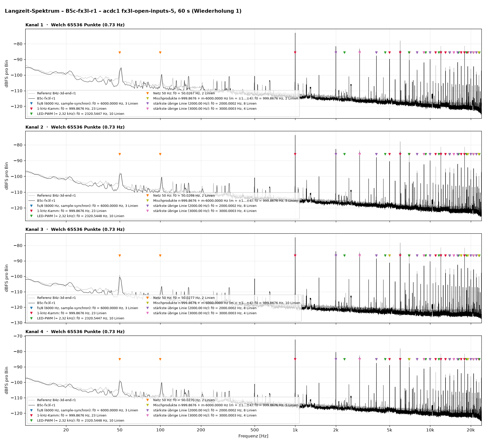
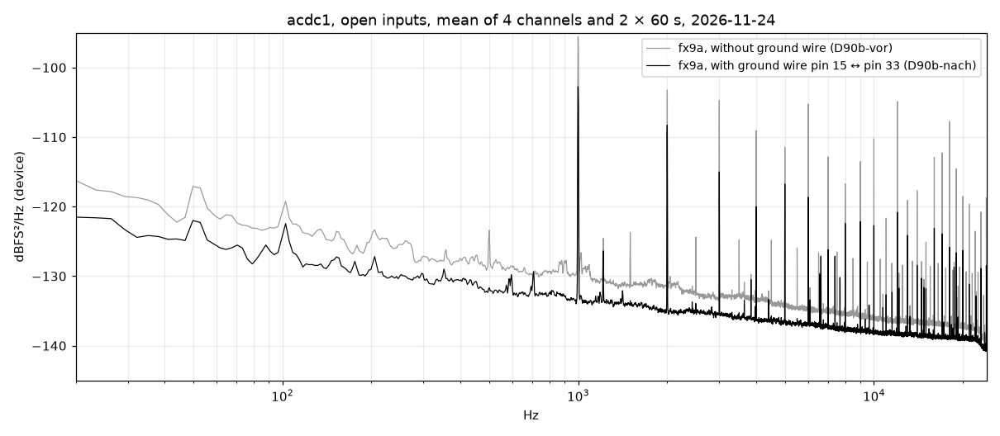

# acdc-workbench

Eine Werkbank für das **Befaco / Rebel Technology AC/DC**, das Eurorack-USB-Audiointerface mit OpenWare-Firmware. Sie liest das Modul aus, nimmt automatisch auf, wertet das Rauschspektrum aus, baut die Firmware reproduzierbar und protokolliert jeden Flash.

Anlass war das Rauschen in meinen AC/DC-Aufnahmen. Die Werkzeuge, die dabei entstanden sind, sind inzwischen das wichtigste Ergebnis. Die Firmware selbst liegt in einem Fork: [m9dfukc/OpenWare](https://github.com/m9dfukc/OpenWare), Branch `acdc/fx1d`, hier als Submodul eingebunden. Die eigenen OWL-Patches liegen in [m9dfukc/acdc-patches](https://github.com/m9dfukc/acdc-patches), eingebunden als Submodul `owl/`.

> **Inoffiziell und eng gefasst.** Gemessen wurde an einem Modul, mit einem Rechner, unter macOS. Ein zweites Modul dient als unberührte Referenz. Flashen geschieht auf eigene Gefahr: vorher die Firmware des eigenen Moduls sichern.

English version: [README.md](README.md)

## Was die Werkbank kann

| Werkzeug | Zweck |
|---|---|
| `tools/acdc_rec.py` | Nimmt mit festem Aufbau auf (4 Kanäle, 48 kHz), gibt Testsignale aus (Sinus, Gleichanteil, Rampen), benennt die Datei und legt den Eintrag in `recordings/manifest.toml` an |
| `python -m analysis` | Rauschanalyse einer Aufnahme: Langzeit-Spektrum, gemessene Linienfrequenzen, Linienfamilien (USB-Frame-Kamm, fs/8, Mischprodukte, LED-PWM, Netz), Zeitverlauf, Report als Markdown, JSON und Plots |
| `tools/family_table.py` | Tabelle der Familienpegel über mehrere Messungen, mit Differenz zur Kontrolle |
| `tools/owl_read.py` | Liest das Modul per MIDI/SysEx aus, ohne zu schreiben: Firmware-Version, Settings, Patch-Slots, Statusmeldung. Kann es in den DFU-Bootloader neu starten |
| `tools/owl_write.py` | Lädt einen OWL-Patch per MIDI/SysEx hoch: nur im RAM starten oder in einen Slot speichern. Sichert einen belegten Slot vorher und liest den neuen danach zurück. Löscht auf Wunsch einen einzelnen Slot, nur mit passender lokaler Kopie |
| `tools/build_owl_patch.sh` | Baut einen C++-Patch mit OwlProgram für das AC/DC und schreibt die SysEx-Datei für `owl_write.py` |
| `tools/sim_boot_menu.sh` | Testet die Logik des Boot-Menüs (Patch 15 und 17: Slot und LED-Modus) am Rechner mit simulierten Reglern, dazu, was die Hauptschleife je LED-Modus an die LEDs schreibt |
| `tools/test_owl_dsp.sh` | Tests der eigenen OWL-Patches in `owl/` am Rechner (Waveshaper, Limiter, Allpass-Kette, Sperre für die Blockraten-Linien, LED-Mess-Patches) |
| `tools/dfu_readback.sh`, `tools/compare_firmware.py` | Internes Flash über DFU lesen und mit einer Referenz vergleichen |
| `tools/dump_stress.py` | Stresstest für den MIDI-Sendeweg: lädt bei laufendem Patch alle Slots immer wieder herunter und zählt beschädigte Downloads |
| `tools/flash_acdc.py` | Flasht einen Build über DFU und führt ein Flash-Log: prüft das Binary offline, liest das Modul aus, startet es in den DFU-Modus, schreibt, liest zurück und vergleicht, startet danach die Firmware mit einem nur lesenden `dfu-util … :leave` und prüft das Modul (A1). `--cold` wartet stattdessen auf einen Neustart von Hand, `--a1` prüft danach. Über die Geräte-ID an das Testmodul des Autors gebunden |
| `tools/build_acdc.sh` | Reproduzierbarer Firmware-Build aus Commit, festem Libraries-Tarball und Patch-Liste. Schreibt `BUILD_INFO.txt` mit allen Prüfsummen |
| `tools/check_itcm.py` | Prüft einen ITCM-Build am ELF vor dem Flash: was liegt wo, welche Aufrufe verlassen das ITCM, Vergleich mit einem Referenz-Build |
| `tools/phase_slips.py`, `tools/stale_samples.py` | Prüfen eine Loop-Aufnahme (Out → In) auf verlorene oder doppelte Samples und auf einzelne veraltete Samples |
| `tools/line_levels.py` | Pegel einzelner Linien je Kanal, direkt bei der Linienfrequenz gemessen, über mehrere Aufnahmen, mit Abstand zum Grundrauschen |
| `tools/crosstalk_lines.py`, `tools/click_sensitivity.py` | Übersprechen von Testtönen der Ausgänge auf die Eingänge; Empfindlichkeit des Klick-Detektors für eingebaute USB-Fehler |
| `tools/ledpath_phases.py` | Pegel je Phase einer Aufnahme mit dem Mess-Patch für den LED-Pfad, an einem zweiten Interface aufgenommen und über einen eingebauten Eichton auf den Ausgang des Moduls umgerechnet |
| `tools/ab_bands.py` | A/B/A-Vergleich dreier Aufnahmen, etwa alter Build, neuer Build, alter Build: Pegel, Terzbänder gegen die Streuung der A-Läufe, neue Linien, Knackser |
| `tools/knob_series.py` | Geführte Aufnahmeserie mit den Reglern in vorgegebenen Stellungen: liest die Regler per MIDI, wartet auf die Stellung, nimmt auf und schreibt am Ende eine Tabelle der Linienpegel |

## Befunde bisher

- **Vier Familien von Störlinien** stecken in den ADC-Daten, auf allen Kanälen stark korreliert:
  - ein Kamm bei k · ≈1 kHz
  - eine Linie bei fs/8 = 6000 Hz, der Audio-Blockrate bei Blockgröße 8
  - Mischprodukte der beiden
  - eine LED-PWM-Linie bei 2321 Hz
- **Der Kamm folgt dem USB-Start-of-Frame des Host-Controllers.** Seine Grundfrequenz hängt vom USB-Anschluss ab (999,87 bis 1000,00 Hz im Takt des Moduls). An den Ausgängen verschwindet er ohne USB.
- **Die Lage des Codes im Flash verschiebt die Linien.** Ein Build, der nur Füllbytes ergänzt und an der Funktion nichts ändert, hat die Familien um 1,5 bis 4,5 dB verschoben.
- **Periodisch laufender Code im ITCM hilft.** Mit dem heißen Pfad im ITCM sinkt die fs/8-Linie um rund 5 dB, die Mischprodukte verschwinden, und das Ergebnis hängt nicht mehr von der Flash-Lage ab.
- **Kleine Linien aus den Takten der MCU.** Der frei laufende Regler-ADC scannt mit 105,634 kHz und erscheint gefaltet bei 9633,8 Hz, etwa −118 dBFS. Eine weitere Gruppe von Linien (2200,95 Hz und Harmonische) steigt, wenn die vier Regler verschieden stehen: Ein Regler am Anschlag bringt sie auf etwa −100 dBFS, abwechselnde Anschläge auf −94 dBFS, immer noch 19 dB unter dem Kamm. Stehen alle vier Regler gleich, egal wo, bleibt sie bei etwa −116 dBFS. Woher ihre Frequenz kommt, ist offen.
- **Der LED-Strom verschiebt den Nullpunkt aller Eingänge.** Jede leuchtende Eingangs-LED verschiebt die rohen ADC-Daten aller Kanäle um etwa −2,9 mV (−71 dBFS). Eine dauerhaft leuchtende LED ist still, jeder Wechsel ist ein Knack, und eine gedimmte LED wiederholt den Sprung 2321-mal pro Sekunde: Das ist die LED-PWM-Linie. Ein Patch, der seinen Eingang durchreicht, bringt all das an die Ausgänge. Build 9 (`v22.4.r-fx7a`) lässt die LED-PWM mit 48 kHz im Takt der Abtastung laufen: Die Linie bei 2321 Hz ist an Ein- und Ausgängen weg, die langsame Verschiebung bleibt. Dagegen halten die LED-Modi nur Clip und aus (Build 8, `v22.4.r-fx6a`) die LEDs dunkel, im Modus aus sinkt die Verschiebung um etwa 37 dB.
- **Was ein Patch tut, kommt an die Ausgänge.** Ein FX-Patch reicht die Linien seines Eingangs weiter, und seine Rechenlast hebt die Blockraten-Linie: Eine Allpass-Kette mit 29 % CPU hob fs/8 um 3,8 dB und die Mischprodukte um 13,4 dB gegen den Default-Patch mit 6 %. Ein Patch, der eine LED dimmt, brachte die Linie bei 2321 Hz mit bis zu −44 dBFS an den Ausgang. Weit auseinander stehende Regler bringen ihre eigenen Linien an den Ausgang (−66 bis −73 dBFS am Eingang eines Interfaces, ein Regler am Anschlag). Eine Sperre, die die Blockraten-Linien in der Stille lernt und am Eingang abzieht (`owl/AcdcInput.h`), senkte sie am Ausgang um 22 bis 25 dB.
- **Ein Draht zwischen zwei Massepins auf dem Prozessor-Modul ist bisher die wirksamste Einzelmaßnahme.** Auf dem Modul treffen sich die Masse des Codecs (AGND) und die digitale Masse (GND) nur über eine Ferritperle, der Träger legt alle AGND-Pins direkt auf seine Masse. Ein kurzer Draht von Pin 15 (GND) zu Pin 33 (AGND) auf der Rückseite des Moduls senkte den Kamm um 7 dB, fs/8 um 18 dB und den breitbandigen Boden um 3 dB und die LED-Verschiebung der Eingänge auf ein Viertel. Verstärkung und USB bleiben gleich. Siehe den Abschnitt unten und [docs/06-hardware-mod-masse.md](docs/06-hardware-mod-masse.md).
- **Der Einbau ins Case** änderte in den ADC-Daten nichts Messbares.
- **Das Rauschen driftet innerhalb einer Sitzung.** Der Kamm stieg in einer Sitzung um 2,4 dB in 26 Minuten, in einer anderen um 2 dB, auch über einen Kaltstart hinweg. Vergleiche zwischen Builds brauchen deshalb eine Kontrolle am Anfang und am Ende.
- **Das Modul fiept hörbar**, leise, bei etwa 800 bis 1000 Hz, auch im DFU-Modus ohne laufende Firmware. Ohne USB wird es leiser und höher. Die Quelle (ein Regler auf dem Modul oder im Netzteil des Cases) ist offen.
- **Die Caches der MCU waren aus.** `hardware.h` schaltet Befehls- und Daten-Cache nur ein, wenn `NDEBUG` gesetzt ist, und der Release-Build setzt es nie (auch in v22.5.0 und im Upstream-`master`). Jeder Patch lief etwa fünfmal langsamer als nötig: Der Plateau-Port brauchte 5000 Takte pro Sample bei rund 1000 Befehlen. Build 10 (`v22.4.r-fx8a`) schaltet den Befehls-Cache ein: Plateau sinkt von 51 % auf 35 % CPU, fs/8 steigt um 0,6 dB, das übrige Rauschen bleibt gleich. Patches im DTCM (Standard der Patch-Library) werden nicht schneller, nur solche im AXI-SRAM. Build 11 (`v22.4.r-fx9a`) schaltet auch den Daten-Cache ein, die DMA-Puffer liegen in einer MPU-Region ohne Cache: Plateau sinkt weiter auf 29 % CPU, fs/8 fällt um 0,7 dB gegen `fx8a`, keine neue Linie (D87 bis D89).
- **Vier Fehler im ursprünglichen Code** wurden dabei gefunden und behoben: drei Timing-Fehler im USB-Audio-Pfad (ein Feedback in offener Schleife, ein Wettlauf zwischen RX- und TX-DMA, ein Start-of-Frame-Handler, der zweimal je Frame lief) und ein ungeschützter MIDI-Sendeweg, der Slot-Downloads neben einem laufenden Patch beschädigte.
- **Bekannt und nicht behoben:** Ein Program Change bei offenem USB-Audio-Stream bricht die Wiedergabe bis zum nächsten Stream-Start (rund 10 % Stille). Den Patch vor dem Öffnen des Streams wechseln.

Rauschen der Alltags-Firmware `v22.4.r-fx8a` gegen die Original-Firmware des Testmoduls (der Werks-Build mit dem Etikett v22.5.0), gemessen in einer Sitzung mit `fx8a` vor und nach dem Original (D86): offene Eingänge, Gain auf 12 Uhr, 2 × 60 s für das Original und 4 × 60 s für `fx8a`, Pegel in dBFS des USB-Stroms. Die Original-Firmware nimmt nach der Verstärkung des Default-Patches auf, ihre Pegel sind deshalb je Kanal um den Gain korrigiert, gemessen über den DC-Offset der offenen Eingänge. Die letzten drei Spalten zeigen einzelne Build-Schritte, je in einer eigenen Sitzung gegen eine Kontrolle gemessen (D48, D85, D89). Die heutige Alltags-Firmware `fx9a` ist nur gegen `fx8a` gemessen (letzte Spalte). Zwischen Sitzungen driften die Pegel um bis zu etwa 3 dB, belastbar sind deshalb nur Differenzen innerhalb einer Sitzung.

| Größe | Original | `fx8a` | Differenz | `fx2d` → `fx3l` | `fx7a` → `fx8a` | `fx8a` → `fx9a` |
|---|---|---|---|---|---|---|
| RMS ≥ 20 Hz | −77,0 | −78,8 | −1,8 dB | −1,1 dB | ±0,1 dB | −0,2 … −0,4 dB |
| Breitbandrauschen ohne Linien | −81,6 | −84,9 | −3,2 dB | −1,3 dB | +0,1 dB | −0,1 … −0,6 dB |
| 1-kHz-Kamm (Summe) | −81,0 | −80,8 | +0,2 dB | +0,2 … +0,4 dB | −0,6 … +0,1 dB (Drift) | −0,1 … −0,2 dB |
| fs/8-Linie bei 6000 Hz | −83,1 | −88,3 | −5,2 dB | −5,1 dB | +0,6 dB | −0,7 dB |
| Mischprodukte | −96,5 | −119,1 | −22,6 dB | ≈ −35 dB | +1,0 … +3,4 dB | −4,4 … +1,9 dB (Streuung) |
| LED-PWM-Linie bei 2320,5 Hz | ≈ −118 | nicht gefunden | weg | | | |



Der Kamm ist damit die stärkste verbleibende Familie. Die Alltags-Firmware auf dem Testmodul ist seit 2026-11-23 `v22.4.r-fx9a`: `fx3l` plus ein Boot-Menü, das den Patch-Slot mit den Reglern wählt (`fx4b`), ein Fix für den MIDI-Sendeweg (`fx5a`), ein LED-Modus normal / nur Clip / aus, im Boot-Menü gewählt (`fx6a`), die LED-PWM mit 48 kHz im Takt der Abtastung (`fx7a`) der eingeschaltete Befehls-Cache (`fx8a`, D83 bis D85) und der Daten-Cache mit den DMA-Puffern in einer MPU-Region ohne Cache (`fx9a`, D87 bis D89). Mit `fx7a` ist die LED-PWM-Linie bei 2321 Hz an Ein- und Ausgängen weg, das Rauschen ist innerhalb von 0,15 dB gleich dem von `fx6a` (D78, D79). Mit `fx4b` kamen 19 von 79 Slot-Downloads neben einem laufenden Patch beschädigt an, danach hing MIDI bis zum Neustart. Mit `fx5a` waren 240 von 240 in Ordnung (D62, D63). Das Rauschen von `fx4b` ist innerhalb von ±0,4 dB gleich dem von `fx3l` (Kontrolle in derselben Sitzung), `fx5a` zeigt keine Änderung über die Streuung der Sitzung hinaus (D64). Einzelheiten und alle Zahlen: [docs/messlog.md](docs/messlog.md), Einträge D45 bis D49 und D50 bis D89.

### Hardware-Mod: Masse-Draht auf dem Modul

Das Testmodul trägt seit 2026-11-24 einen Hardware-Mod: einen isolierten Draht von Pin 15 (GND) zu Pin 33 (AGND) auf der Rückseite des Prozessor-Moduls Xibeca, parallel zur Ferritperle L1, die auf dem Modul die beiden Massen verbindet. Gemessen am selben Tag mit `fx9a` vor und nach dem Löten (D90): offene Eingänge, Gain auf 12 Uhr, je 2 × 60 s, dBFS des USB-Stroms, Mittel der vier Kanäle. Alle Zahlen der Tabelle oben sind ohne Draht gemessen.

| Größe | ohne Draht | mit Draht | Differenz |
|---|---|---|---|
| RMS ≥ 20 Hz | −78,7 | −84,4 | −5,7 dB |
| Breitbandrauschen ohne Linien | −84,1 | −87,0 | −2,9 dB |
| 1-kHz-Kamm (Summe) | −80,9 | −88,0 | −7,2 dB |
| fs/8-Linie bei 6000 Hz | −88,9 | −107,1 | −18,3 dB |
| Mischprodukte | −122,4 | nicht gefunden | weg |
| LED-Verschiebung der Eingänge (4 LEDs an) | 100 % | 20 bis 25 % | −12 bis −14 dB |



Der breitbandige Boden sinkt um etwa 4 dB im Bass und 2 dB in den Höhen. Ein Loop-Test (Ausgang → Eingang) zeigt dieselbe Verstärkung auf 0,02 dB und keine verlorenen Samples. Die Linien bei 7384,6, 1215,2 und 4401,9 Hz bleiben, die Scan-Linie des Regler-ADC bei 9633,8 Hz steigt um 3,7 dB, liegt aber bei etwa −126 dBFS. Der Kamm trägt jetzt 30 bis 50 % der Rauschleistung. Am Ausgang, über das zweite Interface gegen eine ältere Messung ohne Draht (D91), sinken der Kamm um 11 dB, fs/8 um 12 dB und die LED-Verschiebung um 12,6 dB. Nicht gemessen: ein erneutes Entfernen des Drahts, das den Wiedereinbau als Ursache ausschließt. Hintergrund, Pin-Tabelle und Schritt-für-Schritt-Anleitung: [docs/06-hardware-mod-masse.md](docs/06-hardware-mod-masse.md). Löten am Modul auf eigenes Risiko.

## Firmware

Der Fork hat zwei Branches:

| Branch | Version | Inhalt |
|---|---|---|
| `acdc/thru-usb-feedback` | `v22.4.r-thru1d` | Der Patch-Ausgang erreicht die Buchsen ohne Rechner, dazu der Fix des USB-Feedbacks |
| `acdc/fx1d` | `v22.4.r-fx9a` | Wie oben. Der Rechner nimmt die rohen Eingänge auf, die Eingangs-LEDs zeigen beim Aufnehmen den rohen Pegel, der heiße Pfad läuft im ITCM, ein Boot-Menü wählt Patch-Slot und LED-Modus und merkt sie sich, der MIDI-Sendeweg ist repariert, die LED-PWM läuft mit 48 kHz, und Befehls- und Daten-Cache sind an |

Beide beruhen auf dem Upstream-Commit `db9d3dd` (v22.4.r) mit den Libraries bei `9e8f64e`. Das README im Fork erklärt, warum, und was jede Änderung tut.

- `firmware/patches/` enthält dieselben Änderungen als nummerierte Patch-Dateien. `tools/build_acdc.sh` wendet sie auf einen sauberen Baum an.
- `firmware/builds/<name>/BUILD_INFO.txt` hält Commit, Toolchain, Patch-Liste und Prüfsummen jedes Builds fest. Die Binaries liegen nicht im Repo, jedes lässt sich bytegleich nachbauen. Fertige Binaries von `v22.4.r-fx2d`, `v22.4.r-fx3l`, `v22.4.r-fx4b`, `v22.4.r-fx5a`, `v22.4.r-fx7a`, `v22.4.r-fx8a` und `v22.4.r-fx9a` (das neueste) hängen an den [Releases des Forks](https://github.com/m9dfukc/OpenWare/releases). `v22.4.r-fx6a` hat kein eigenes Release.
- `firmware/flashlog/` hat je Flash einen Ordner: Geräte-Report davor und danach, DFU-Logs, Prüfsumme des Readbacks.

**Die offizielle `ACDC.bin` v22.5.0 von der Upstream-Release-Seite nicht auf ein AC/DC flashen.** Laut Forum macht sie USB kaputt ([Thread](https://community.rebeltech.org/t/ac-dc-firmware-update/2083)).

## Einstieg

Voraussetzungen: macOS, [uv](https://docs.astral.sh/uv/), `dfu-util` für Readback und Flashen, Arm GNU Toolchain 12.2.Rel1 für Firmware-Builds.

```sh
git clone https://github.com/m9dfukc/acdc-workbench.git
cd acdc-workbench
tools/setup_repo.sh    # Submodule, Upstream-Remote, feste Downloads mit Prüfsumme
uv sync
```

Die Aufrufe für Aufnahme, Loop-Prüfung, Auslesen und Nachbau stehen im englischen [README.md](README.md#getting-started). Der Flash-Ablauf steht in [CLAUDE.md](CLAUDE.md), Abschnitt „Flash-Ablauf“, als Skript in `tools/flash_acdc.py` (am Modul erprobt; der Start per `:leave` im Skript bisher nur ohne Modul, von Hand am Modul zweimal erfolgreich).

## Aufbau des Repos

| Pfad | Inhalt |
|---|---|
| `tools/`, `analysis/` | Die Werkbank |
| `docs/` | Referenz-Docs `01` bis `06` (`06` ist der Masse-Mod), das Laborbuch `messlog.md`, Recherche-Notizen in `docs/research/` |
| `docs/en/` | Englische Fassungen der Referenz-Docs, siehe [docs/en/README.md](docs/en/README.md) |
| `firmware/OpenWare/` | Submodul, der Firmware-Fork |
| `firmware/patches/`, `firmware/builds/`, `firmware/flashlog/` | Patches, Build-Protokolle, Flash-Protokolle |
| `owl/` | Submodul [acdc-patches](https://github.com/m9dfukc/acdc-patches), eigene OWL-Patches für das Modul: `Tanh3` in `owl/tanh3/` (dreifacher tanh-Waveshaper mit Mix-Kanal), `Schliere` in `owl/schliere/` (Kette aus 61 Allpässen 2. Ordnung: Laufzeit je Frequenz, Phaser-Kerben, Resonator, mono hinein und stereo heraus; sieben Varianten, beschrieben in `owl/schliere/README.md`), ein Ausgangs-Limiter für FX-Patches und eine Sperre für die Blockraten-Linien am Eingang, mit Tests am Rechner. In `owl/test/` liegen dazu zwei Mess-Patches, die die LEDs nach Zeitplan schalten und die LED-Verschiebung selbst an den rohen Eingängen messen. |
| `recordings/manifest.toml` | Metadaten jeder Aufnahme |
| `out/<ID>/` | Analyse-Report je Messung |
| `TODO.md`, `CLAUDE.md` | Offene Punkte und der Projektkontext für die Arbeit mit Claude Code |

Nicht im Repo: die Aufnahmen selbst (8 GB WAV), Plots und JSON-Ergebnisse in `out/`, Firmware-Binaries, die Geräte-Backups sowie fremde OWL-Patch-Quellen ohne Lizenz samt ihren Builds (`owl-patches/`). Plots und Ergebnisse erzeugt `python -m analysis` aus den Aufnahmen neu.

## Sprache

Die Arbeitsdokumente sind deutsch und bleiben es, Deutsch ist die Quelle.

- Englische Fassungen der Referenz-Docs `01` bis `05` und `99` liegen in [docs/en/](docs/en/README.md). Sie werden aus dem Deutschen erzeugt und zu Meilensteinen aufgefrischt. `python tools/i18n_check.py` listet veraltete Fassungen auf.
- Das Laborbuch `docs/messlog.md`, `TODO.md` und `CLAUDE.md` gibt es nur auf Deutsch.
- Die Werkzeuge geben Hilfe und Meldungen auf Englisch aus. Die Reports der Analyse sind deutsch.
- Die Recherche-Notizen in `docs/research/notes/` sind englisch.

## Lizenz

Werkzeuge MIT, Firmware-Patches GPL-2.0, OWL-Patches (Submodul `owl/`) GPL-3.0-or-later, Dokumente und Messdaten CC BY 4.0. Einzelheiten: [LICENSE.md](LICENSE.md).
