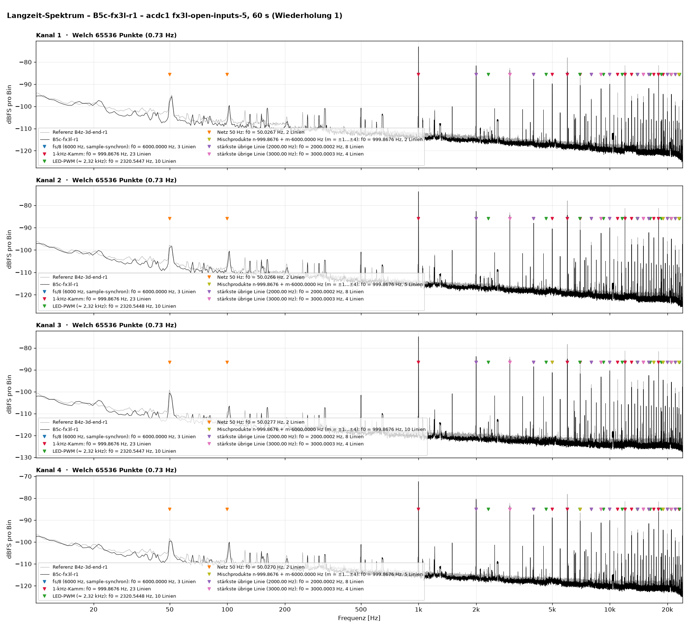

# acdc-workbench

A workbench for the **Befaco / Rebel Technology AC/DC**, the Eurorack USB audio interface that runs the OpenWare firmware. It reads out the module, records from it automatically, analyses the noise spectrum, builds the firmware reproducibly and documents every flash.

It started as a hunt for the noise in my AC/DC recordings. The tooling that grew around that hunt is now the main result. The firmware itself lives in a fork: [m9dfukc/OpenWare](https://github.com/m9dfukc/OpenWare), branch `acdc/fx1d`, included here as a submodule. The own OWL patches live in [m9dfukc/acdc-patches](https://github.com/m9dfukc/acdc-patches), included as the submodule `owl/`.

> **Unofficial, and narrow in scope.** Everything was measured on one module, with one computer, on macOS. A second module serves as an untouched reference. Flashing is at your own risk: back up the firmware of your module first.

Deutsche Fassung: [README.de.md](README.de.md)

## What the workbench does

| Tool | Purpose |
|---|---|
| `tools/acdc_rec.py` | Records from the module with a fixed setup (4 channels, 48 kHz), plays test signals (sine, DC, ramps) on the outputs, names the file and writes the entry in `recordings/manifest.toml` |
| `python -m analysis` | Noise analysis of a recording: long-term spectrum, measured line frequencies, line families (USB frame comb, fs/8, mixing products, LED PWM, mains), level over time, report as Markdown, JSON and plots |
| `tools/family_table.py` | Table of family levels across several measurements, with the difference to a control |
| `tools/owl_read.py` | Reads the module over MIDI/SysEx without writing: firmware version, settings, patch slots, status message. Can restart it into the DFU bootloader |
| `tools/owl_write.py` | Uploads an OWL patch over MIDI/SysEx: run it from RAM only or store it in a slot. Backs up an occupied slot first and reads the new one back afterwards. Can delete a single slot, only with a matching local copy |
| `tools/build_owl_patch.sh` | Builds a C++ patch with OwlProgram for the AC/DC and writes the SysEx file for `owl_write.py` |
| `tools/sim_boot_menu.sh` | Tests the boot menu logic (patches 15 and 17: slot and LED mode) on the host with simulated knobs, plus what the main loop writes to the LEDs in each LED mode |
| `tools/test_owl_dsp.sh` | Host tests of the own OWL patches in `owl/` (waveshaper, limiter, allpass chain, block-rate canceller, LED measurement patches) |
| `tools/dfu_readback.sh`, `tools/compare_firmware.py` | Read the internal flash over DFU and compare it with a reference binary |
| `tools/dump_stress.py` | Stress test for the MIDI send path: downloads all slots again and again while a patch is running and counts damaged downloads |
| `tools/flash_acdc.py` | Flashes a build over DFU with a flash log: checks the binary offline, reads the module, restarts it into DFU, writes, reads back and compares, then starts the firmware with a read-only `dfu-util … :leave` and checks the module (A1). `--cold` waits for a restart by hand instead, `--a1` checks after it. Tied to the author's test module by its device ID |
| `tools/build_acdc.sh` | Reproducible firmware build from a commit, a pinned library tarball and a list of patches. Writes `BUILD_INFO.txt` with all checksums |
| `tools/check_itcm.py` | Checks an ITCM build on the ELF before it is flashed: what sits where, which calls leave ITCM, comparison with a reference build |
| `tools/phase_slips.py`, `tools/stale_samples.py` | Check a loop-back recording (out → in) for lost or repeated samples and for single stale samples |
| `tools/line_levels.py` | Level of single lines per channel, measured right at the line frequency, across several recordings, with the distance to the noise floor |
| `tools/crosstalk_lines.py`, `tools/click_sensitivity.py` | Crosstalk of test tones from the outputs to the inputs; sensitivity of the click detector to injected USB faults |
| `tools/knob_series.py` | Guided series of recordings with the knobs in given positions: reads the knobs over MIDI, waits until they are in place, records, and writes a table of the line levels at the end |

## Findings so far

- **Four families of interference lines** sit in the ADC data, strongly correlated across all channels:
  - a comb at k · ≈1 kHz
  - a line at fs/8 = 6000 Hz, the audio block rate at block size 8
  - mixing products of the two
  - an LED PWM line at 2321 Hz
- **The comb follows the USB start-of-frame of the host controller.** Its fundamental changes with the USB port (999.87 to 1000.00 Hz in the module's clock). On the outputs it disappears without USB.
- **Where code sits in flash shifts the lines.** A build that only adds padding, with no change in function, moved the families by 1.5 to 4.5 dB.
- **Running the periodic code from ITCM helps.** With the hot path in ITCM, the fs/8 line drops by about 5 dB, the mixing products disappear, and the result no longer depends on the flash layout.
- **Small lines from the MCU's own clocks.** The free-running knob ADC scans at 105.634 kHz and shows up folded at 9633.8 Hz, about −118 dBFS. A further set of lines (2200.95 Hz and its harmonics) rises when the four knobs are set differently: one knob at an end stop brings it to about −100 dBFS, alternating stops to −94 dBFS, still 19 dB below the comb. With all four knobs alike, at whatever position, it stays near −116 dBFS. Where its frequency comes from is open.
- **LED current shifts the zero point of all inputs.** Each lit input LED moves the raw ADC data of every channel by about −2.9 mV (−71 dBFS). A steadily lit LED is silent, every change is a click, and a dimmed LED repeats the step 2321 times a second: that is the LED PWM line. A patch that passes its input on carries all of it to the outputs. Build 9 (`v22.4.r-fx7a`) runs the LED PWM at 48 kHz, locked to the sample clock: the 2321 Hz line is gone from inputs and outputs, the slow shift stays. Against that, the LED modes clip only and off (Build 8, `v22.4.r-fx6a`) keep the LEDs dark; in mode off the shift drops by about 37 dB.
- **What a patch does reaches the outputs.** An FX patch passes the lines of its input on, and its own CPU load raises the block-rate line: an allpass chain at 29 % CPU lifted fs/8 by 3.8 dB and the mixing products by 13.4 dB against the default patch at 6 %. A patch that dims an LED put the 2321 Hz line on the output at up to −44 dBFS. Knobs set far apart bring their own lines to the output (−66 to −73 dBFS at an interface input with one knob at its stop). A canceller that learns the block-rate lines in silence and subtracts them at the input (`owl/AcdcInput.h`) lowered them at the output by 22 to 25 dB.
- **Mounting in the case** changed nothing measurable in the ADC data.
- **The noise drifts within a session.** The comb rose by 2.4 dB in 26 minutes in one session and by 2 dB in another, also across a cold start. Comparisons between builds therefore need a control at the beginning and at the end.
- **The module whines audibly**, quietly, at roughly 800 to 1000 Hz, also in DFU mode without any firmware running. Unplugging USB makes it quieter and higher. The source (a regulator on the module or in the case supply) is open.
- **The MCU's caches were off.** `hardware.h` turns the instruction and data caches on only when `NDEBUG` is defined, and the Release build never defines it (also in v22.5.0 and upstream `master`). Every patch ran about five times slower than necessary: the Plateau port needed 5000 cycles per sample for about 1000 instructions. Build 10 (`v22.4.r-fx8a`) turns the instruction cache on: Plateau drops from 51 % to 35 % CPU, fs/8 rises by 0.6 dB, the rest of the noise is unchanged. Patches linked to DTCM (the patch library default) do not get faster, only those in AXI SRAM. The data cache stays off for now.
- **Four bugs in the original code** were found and fixed on the way: three timing bugs in the USB audio path (a feedback loop that ran open, a race between the RX and TX DMA, a start-of-frame handler that ran twice per frame) and an unprotected MIDI send path that damaged slot downloads next to a running patch.
- **Known and not fixed:** a Program Change while the USB audio stream is open breaks playback until the next stream start (about 10 % silence). Change the patch before opening the stream.

Firmware `v22.4.r-fx3l` against the previous build `v22.4.r-fx2d`, open inputs, gain at 12 o'clock, 2 × 60 s each, levels in dBFS of the USB stream:

| Measure | `fx2d` | `fx3l` | Difference |
|---|---|---|---|
| RMS ≥ 20 Hz | −77.6 | −78.7 | −1.1 dB |
| Broadband floor without lines | −83.2 | −84.5 | −1.3 dB |
| 1 kHz comb (sum) | −80.9 | −80.6 | +0.2 … +0.4 dB |
| fs/8 line at 6000 Hz | −84.3 | −89.4 | −5.1 dB |
| Mixing products | −90.8 | ≈ −125 | ≈ −35 dB |



The comb is now the strongest remaining family. The current daily firmware on the test module is `v22.4.r-fx8a` (since 2026-11-23): `fx3l` plus a boot menu that chooses the patch slot with the knobs (`fx4b`), a fix for the MIDI send path (`fx5a`), an LED mode normal / clip only / off chosen in the boot menu (`fx6a`), the LED PWM at 48 kHz, locked to the sample clock (`fx7a`), and the instruction cache switched on (`fx8a`, D83 to D85). With `fx7a` the LED PWM line at 2321 Hz is gone from inputs and outputs, and the noise is the same as with `fx6a` within 0.15 dB (D78, D79). With `fx4b`, 19 of 79 slot downloads next to a running patch arrived damaged and MIDI then hung until a power cycle; with `fx5a` 240 of 240 were intact (D62, D63). The noise of `fx4b` is the same as that of `fx3l` within ±0.4 dB (control in the same session), and `fx5a` shows no change beyond the session scatter (D64). Details and all numbers: [docs/messlog.md](docs/messlog.md) (German), entries D45 to D49, D50 to D85.

## Firmware

The fork has two branches:

| Branch | Version | Content |
|---|---|---|
| `acdc/thru-usb-feedback` | `v22.4.r-thru1d` | The patch output reaches the jacks without a computer, plus the USB feedback fix |
| `acdc/fx1d` | `v22.4.r-fx7a` | As above. The computer records the raw inputs, the input LEDs show the raw level while recording, the hot path runs from ITCM, a boot menu chooses the patch slot and the LED mode and remembers them, the MIDI send path is fixed, and the LED PWM runs at 48 kHz |

Both are based on upstream commit `db9d3dd` (v22.4.r) with the libraries at `9e8f64e`. The fork README explains why, and what each change does.

- `firmware/patches/` holds the same changes as numbered patch files. `tools/build_acdc.sh` applies them to a clean tree.
- `firmware/builds/<name>/BUILD_INFO.txt` records commit, toolchain, patch list and checksums of every build. The binaries are not in this repository, each one can be rebuilt byte for byte. Ready-made binaries of `v22.4.r-fx2d`, `v22.4.r-fx3l`, `v22.4.r-fx4b`, `v22.4.r-fx5a` and `v22.4.r-fx7a` (the latest) are attached to the [releases of the fork](https://github.com/m9dfukc/OpenWare/releases). `v22.4.r-fx6a` has no release of its own.
- `firmware/flashlog/` has one folder per flash: device report before and after, DFU logs, checksum of the readback.

**Do not flash the official `ACDC.bin` v22.5.0 from the upstream release page onto an AC/DC.** It is reported to break USB ([forum thread](https://community.rebeltech.org/t/ac-dc-firmware-update/2083)).

## Getting started

Requirements: macOS, [uv](https://docs.astral.sh/uv/), `dfu-util` for readback and flashing, Arm GNU Toolchain 12.2.Rel1 for firmware builds.

```sh
git clone https://github.com/m9dfukc/acdc-workbench.git
cd acdc-workbench
tools/setup_repo.sh    # submodules, upstream remote, pinned downloads with checksum
uv sync
```

Record open inputs twice for 60 s and analyse both takes:

```sh
uv run python tools/acdc_rec.py --list
uv run python tools/acdc_rec.py --id T1 --test open-inputs --duration 60 --reps 2 --analyze
```

Check USB stability with patch cables from each output to its input:

```sh
uv run python tools/acdc_rec.py --id L1 --test loop-sine --sine 440 530 670 790 --owl-read
uv run python tools/phase_slips.py recordings/<file>.wav --freqs 440 530 670 790
uv run python tools/stale_samples.py recordings/<file>.wav --freqs 440 530 670 790
```

Read out a module, including all patch slots. This tool needs Python 3.12 and two MIDI packages that are not in `pyproject.toml`:

```sh
uv run --no-project --python 3.12 --with mido --with python-rtmidi \
  python tools/owl_read.py --dump --out backup
```

Rebuild `v22.4.r-fx7a`. The result must have the SHA-256 `cac6fee0f86426aed3d9b5bfaa2ff758b69de59ed7e11971f2a2ba0d0233ff20`:

```sh
P=firmware/patches
FW_VERSION=v22.4.r-fx7a tools/build_acdc.sh my-fx7a db9d3dd \
  firmware/downloads/OpenWareLibraries-9e8f64e.tar.gz \
  $P/01-gcc12-extern-uint8.patch $P/02-revert-237c63d-thru-mute.patch \
  $P/04-output-gain-125.patch $P/05-atomic-usbd-rx-count.patch \
  $P/06-fb-level-control.patch $P/03-tx-pre-fx-owl-acdc-fx.patch \
  $P/07d-input-leds-raw-late-section.patch $P/08-upstream-gcc13-build-flags.patch \
  $P/11g-itcm-hotpath-rxcb.patch $P/12b-rx-dma-callback.patch \
  $P/14-usbd-sof-once-per-frame.patch $P/15b-boot-menu-slot-select-30s.patch \
  $P/16-midi-tx-atomic.patch $P/17-led-mode-boot-menu.patch \
  $P/18-led-pwm-48k.patch
```

The flash procedure (read out, restart into DFU, write, read back, compare, leave DFU) is described in [CLAUDE.md](CLAUDE.md), section "Flash-Ablauf". `tools/flash_acdc.py` runs these steps and keeps a flash log. It has been used on the module; the `:leave` start inside the script has so far only been tested without the module, by hand it worked twice on the module and gave the same noise as a cold start. It only accepts the author's test module: the MIDI device ID and the DFU serial number are constants at the top of the script.

```sh
python3 tools/flash_acdc.py acdc1-build9-fx7a          # offline checks only
python3 tools/flash_acdc.py acdc1-build9-fx7a --yes    # flash, leave DFU, check (A1)
python3 tools/flash_acdc.py acdc1-build9-fx7a --yes --cold   # flash, then restart by hand
python3 tools/flash_acdc.py --a1 firmware/flashlog/<date>_build9-fx7a   # after a restart by hand
```

## Repository layout

| Path | Content |
|---|---|
| `tools/`, `analysis/` | The workbench |
| `docs/` | Reference documents `01` to `05` (German), the lab notebook `messlog.md`, research notes in `docs/research/` |
| `docs/en/` | English versions of the reference documents, see [docs/en/README.md](docs/en/README.md) |
| `firmware/OpenWare/` | Submodule, the firmware fork |
| `firmware/patches/`, `firmware/builds/`, `firmware/flashlog/` | Patches, build records, flash records |
| `owl/` | Submodule [acdc-patches](https://github.com/m9dfukc/acdc-patches), own OWL patches for the module: `Tanh3` in `owl/tanh3/` (triple tanh waveshaper with a mix channel), `Schliere` in `owl/schliere/` (a chain of 61 second-order allpass filters: frequency-dependent delay, phaser notches, resonator, mono in and stereo out; seven variants, described in `owl/schliere/README.md`), an output limiter for FX patches and an input canceller for the block-rate lines, with host tests. `owl/test/` also holds two measurement patches that switch the LEDs on a schedule and measure the LED shift at the raw inputs themselves. |
| `recordings/manifest.toml` | Metadata of every recording |
| `out/<ID>/` | Analysis report of each measurement |
| `TODO.md`, `CLAUDE.md` | Open points and the project context used when working with Claude Code |

Not in the repository: the recordings themselves (8 GB of WAV files), plots and JSON results in `out/`, firmware binaries, the device backups, and third-party OWL patch sources without a license together with their builds (`owl-patches/`). Plots and results can be regenerated from recordings with `python -m analysis`.

## Language

The working documents are written in German and stay that way, German is the source.

- English versions of the reference documents `01` to `05` and `99` are in [docs/en/](docs/en/README.md). They are generated from the German originals and refreshed at milestones. `python tools/i18n_check.py` lists the ones that are out of date.
- The lab notebook `docs/messlog.md`, `TODO.md` and `CLAUDE.md` are German only.
- The tools print English help and messages. Reports generated by the analysis are German.
- The research notes in `docs/research/notes/` are English.

## License

Tools MIT, firmware patches GPL-2.0, OWL patches (submodule `owl/`) GPL-3.0-or-later, documents and measurement data CC BY 4.0. Details: [LICENSE.md](LICENSE.md).
