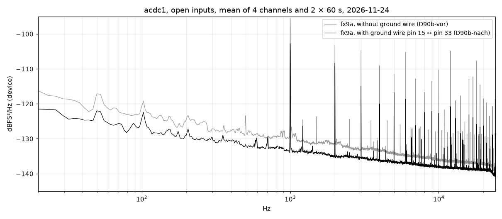

# 06 – Hardware-Mod: Masse-Brücke auf dem Prozessor-Modul

Ein isolierter Draht zwischen zwei Massepins auf der Rückseite des Prozessor-Moduls senkt das Rauschen der Eingänge deutlich. Auf acdc1 seit 2026-11-24, gemessen in `messlog.md`, D90.

> **Auf eigenes Risiko.** Gemessen an einem Modul (acdc1, Xibeca Rev02). Löten am Modul kann es beschädigen. Wer unsicher lötet, lässt es. Der Draht lässt sich wieder entfernen.

## Wirkung [gemessen, D90]

acdc1 mit fx9a, Eingänge offen, Gain 12 Uhr, je 2 × 60 s am selben Tag vor und nach dem Umbau, Geräte-dBFS, Mittel über vier Kanäle:

| Größe | ohne Draht | mit Draht | Δ |
|---|---|---|---|
| RMS ≥ 20 Hz | −78,7 | −84,4 | **−5,7 dB** |
| Rest ohne Störlinien | −84,1 | −87,0 | **−2,9 dB** |
| 1-kHz-Kamm (Summe) | −80,9 | −88,0 | **−7,2 dB** |
| fs/8 (6000 Hz) | −88,9 | −107,1 | **−18,3 dB** |
| Mischprodukte | −122,4 | nicht erkannt | weg |
| Verschiebung der Eingänge durch die LEDs | 100 % | 20–25 % | −12…−14 dB |

Dazu: breitbandiger Boden −4 dB im Bass, −2 dB in den Höhen. Verstärkung, Takt und USB unverändert (Loop-Test ohne Slips, Pegel auf 0,02 dB gleich). Am Ausgang (D91, über einen UMC gemessen) sinken Kamm, fs/8 und LED-Verschiebung um 9–19 dB.



## Hintergrund

Das AC/DC besteht aus der Trägerplatine von Befaco (Buchsen, Op-Amps, Regler, LEDs, Versorgung) und einem aufgesteckten Prozessor-Modul von Rebel Technology, **Xibeca** (rote Platine, MCU, SDRAM, QSPI, Codec PCM3168A) [belegt: Schaltpläne, Foto im Forum].

- Auf dem Modul gibt es zwei Masseflächen: **AGND** (Codec) und **GND** (MCU, Speicher, USB). Verbunden sind sie auf dem Modul nur über die Ferritperle **L1** (0603). L2 und L3 filtern die analogen Versorgungen (+A3V3, +A5V) [Code: Schaltplan Xibeca].
- Die Trägerplatine verbindet alle AGND-Pins des Moduls direkt mit ihrer Masse, an der auch Op-Amps, Buchsenhülsen und der Eurorack-Bus hängen [Code: Schaltplan Befaco]. L1 liegt also parallel zu einem Weg über die Steckerleiste.
- Der Codec misst gegen sein AGND, die Eingangsstufe bezieht sich auf die Masse des Trägers. Jede Spannung zwischen diesen beiden Punkten steht in der Aufnahme.
- [Hypothese] Ein Teil des Rückstroms des Moduls (MCU im Blocktakt, USB im SOF-Takt, LEDs) floss über L1 und die AGND-Fläche zum Träger. Seine Spannung lag zwischen den beiden Bezügen. Der Draht verbindet GND und AGND direkt an der Steckerleiste, der Strom nimmt diesen Weg.
- Hinweis kam aus dem Forum (modwiggler, 2026-11). Der Beitrag nannte den Plan von Noctua2, einem Vorläufer mit derselben Pinbelegung und denselben drei Ferriten.

Quellen: Schaltplan der Trägerplatine <https://www.befaco.org/docs/AC_DC/ACDC_V1_THT_Schematic.pdf>, Plan und Layout des Moduls <https://github.com/RebelTechnology/RebelTechnology/tree/master/Xibeca/schematics> (`Xibeca.sch`, `Xibeca.brd`).

### Die Pins

Nummern wie auf dem Aufdruck des Moduls und im Schaltplan von Befaco:

| Netz | Pins |
|---|---|
| GND | 15, 16, 85, 86 |
| AGND | 33, 47, 48, 49, 50, 67, 71, 72 |
| +3V3 | 1 (zur Prüfung auf Kurzschluss) |
| +5V | 95 (zur Prüfung auf Kurzschluss) |

Der Draht geht von **Pin 15 (GND)** zu **Pin 33 (AGND)**. Beide liegen in derselben Reihe der Stiftleiste mit den Nummern 1–48, 9 Raster auseinander (≈ 23 mm). L1 selbst sitzt auf der Seite des Moduls, die zum Träger zeigt, und ist ohne Abziehen des Moduls nicht erreichbar. Der Draht wirkt elektrisch wie eine Brücke über L1.

## Anleitung

**Werkzeug:** Lötkolben mit feiner Spitze, dünner isolierter Draht (etwa 3 cm, z. B. Kupferlackdraht oder Wire-Wrap), Multimeter mit Durchgangsprüfer, Kaptonband.

**Vorher messen** (optional, aber nur so sieht man den Effekt am eigenen Gerät). Modul im Case, Regler 12 Uhr, keine Kabel, Default-Patch:

```bash
UV_CACHE_DIR=.uv-cache uv run python tools/acdc_rec.py --id GND-vor --test gnd-vor-open-inputs --reps 2 --owl-read
```

Dazu die LED-Verschiebung mit dem Mess-Patch `owl/test/SchliereLedPathPatch.hpp` (gebaut mit `tools/build_owl_patch.sh`, läuft nur im RAM, nichts wird gespeichert), etwa 2 min laufen lassen, mehrmals auslesen und die Zeilen `LEDstat In1-3 …` notieren, danach zurück auf Slot 1:

```bash
uv run --no-project --python 3.12 --with mido --with python-rtmidi python tools/owl_write.py owl/vendor/builds/SchliereLedPath/SchliereLedPath.syx --run
```

```bash
uv run --no-project --python 3.12 --with mido --with python-rtmidi python tools/owl_read.py
```

```bash
uv run --no-project --python 3.12 --with mido --with python-rtmidi python tools/owl_read.py --program 1
```

**Umbau:**

1. Case aus, USB ab, Flachbandkabel ab, Modul aus dem Case nehmen. Hinten sieht man die rote Platine mit den aufgedruckten Pin-Nummern.
2. Pin 15 und Pin 33 suchen (Stiftleiste 1–48, dieselbe Reihe wie die übrigen ungeraden Nummern). Aufdruck mit dem eigenen Modul abgleichen.
3. **Prüfen, stromlos:** Durchgang Pin 15 → Hülse einer Klinkenbuchse und Pin 33 → Hülse müssen piepen. Piept einer nicht: aufhören, das sind nicht die Massepins. Dass Pin 15 und Pin 33 untereinander piepen, ist normal (L1 und der Träger verbinden sie schon).
4. **Referenz notieren:** Widerstand Pin 1 und Pin 95 gegen Pin 15, **schwarze Spitze (COM) auf Pin 15**. Die Polung zählt, weil Halbleiter auf der Platine sitzen. acdc1: 2,293 kΩ und 9,04 kΩ.
5. **Löten:** Draht abisolieren und verzinnen, an Pin 15 und Pin 33 anlöten, höchstens 2–3 s je Pin. Flach führen, keine blanke Stelle in der Nähe anderer Pins, mit Kapton fixieren.
6. **Nachmessen:** Pin 1 und Pin 95 gegen Pin 15 mit derselben Polung. Die Werte müssen etwa gleich sein (acdc1: 2,281 kΩ und 8,9 kΩ, also −0,5 und −1,5 %, das ist Ablesestreuung durch die Kondensatoren). Ein Wert nahe 0 Ω heißt Kurzschluss: nicht einschalten.
7. Modul wieder einbauen, Flachbandkabel richtig herum, einschalten. Mit `owl_read.py` prüfen, ob sich das Gerät meldet (Version, Slots).

**Nachher messen:** wie oben, mit `--id GND-nach`. Vergleich:

```bash
UV_CACHE_DIR=.uv-cache uv run python tools/family_table.py GND-vor-r1 GND-vor-r2 GND-nach-r1 GND-nach-r2 --ref GND-vor-r1 GND-vor-r2
```

Vorher `python -m analysis <ID>` für jede der vier IDs laufen lassen. Ein Effekt zählt, wenn er deutlich über der Drift zwischen Läufen liegt (≈ 0,5 dB, zwischen Sitzungen bis 2–3 dB) bzw. LEDstat um mehr als 5 % fällt.

**Zur Sicherheit:** Loop-Test mit Kabeln Out n → In n (vorher auf Slot 1 schalten, `docs/05` und D75):

```bash
UV_CACHE_DIR=.uv-cache uv run python tools/acdc_rec.py --id GND-nach-loop --test gnd-nach-loop --sine 440 530 670 790 --owl-read
```

Pegel der vier Töne mit einem früheren Loop-Test vergleichen, Slips mit `tools/phase_slips.py` und `tools/stale_samples.py` prüfen.

**Rückbau:** Draht ablöten. Danach ist das Modul wieder im Werkszustand.

## Grenzen und offene Punkte

- Ein Modul, ein Rechner. Ob andere Revisionen des Moduls oder der Trägerplatine gleich reagieren, ist offen.
- Am Ausgang gemessen (D91, gegen D74 ohne Draht): Kamm −11 dB, fs/8 −12 dB, LED-Blinken −12,6 dB, bei digital stummem Ausgang LED-Anteil −9 dB. Nicht gemessen: eine Messung nach erneutem Entfernen des Drahts (A-B-A), eine Hörprobe.
- Nicht gesunken sind die Linien bei 7384,62 und 1215,19 Hz und die Regler-Linie bei 4401,90 Hz. Die Scan-Linie des Regler-ADC bei 9633,80 Hz ist um 3,7 dB gestiegen (−126 dBFS, weit unter dem Kamm). Der DC-Offset der Eingänge rückt um 65–90 mV näher an null.
- Der Kamm bleibt die stärkste Störfamilie.
- **Nicht** L2 oder L3 überbrücken: Sie filtern die Versorgung des Codecs und der Analog-Referenz der MCU.
- Mögliche weitere Versuche: L1 direkt überbrücken (nur möglich, wenn das Modul gesteckt und nicht verlötet ist), zusätzlich Pin 16 ↔ Pin 47/48. Beides ist nicht gemessen.
