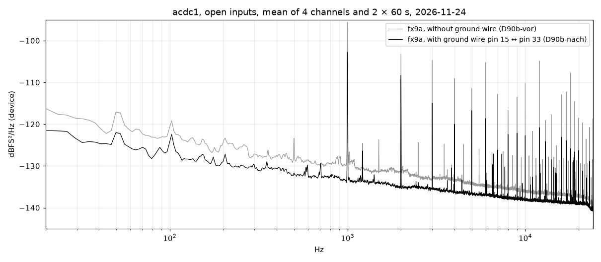

<!-- i18n source=docs/06-hardware-mod-masse.md sha256=b87245630311e651a00067589d7d11d041439b49a0f842b879c344d9e30a7a7f date=2026-11-24 -->
> English translation of [`docs/06-hardware-mod-masse.md`](../../docs/06-hardware-mod-masse.md), as of 2026-11-24. The German original is authoritative. This file is generated from it, do not edit it by hand.

# 06 – Hardware mod: ground wire on the processor module

An insulated wire between two ground pins on the back of the processor module lowers the noise of the inputs clearly. On acdc1 since 2026-11-24, measured in `messlog.md`, D90.

> **At your own risk.** Measured on one module (acdc1, Xibeca Rev02). Soldering on the module can damage it. If you are not confident with a soldering iron, leave it. The wire can be removed again.

## Effect [measured, D90]

acdc1 with fx9a, inputs open, gain at 12 o'clock, 2 × 60 s each on the same day before and after the mod, device dBFS, mean of four channels:

| Measure | Without wire | With wire | Δ |
|---|---|---|---|
| RMS ≥ 20 Hz | −78.7 | −84.4 | **−5.7 dB** |
| Residual without interference lines | −84.1 | −87.0 | **−2.9 dB** |
| 1 kHz comb (sum) | −80.9 | −88.0 | **−7.2 dB** |
| fs/8 (6000 Hz) | −88.9 | −107.1 | **−18.3 dB** |
| Mixing products | −122.4 | not detected | gone |
| Shift of the inputs caused by the LEDs | 100 % | 20–25 % | −12…−14 dB |

In addition: broadband floor −4 dB in the bass, −2 dB in the treble. Gain, clock and USB unchanged (loop test without slips, levels equal within 0.02 dB). At the output (D91, measured through a UMC) the comb, fs/8 and the LED shift drop by 9–19 dB.



## Background

The AC/DC consists of Befaco's carrier board (jacks, op amps, knobs, LEDs, power supply) and a plug-on processor module from Rebel Technology, **Xibeca** (red board, MCU, SDRAM, QSPI, codec PCM3168A) [sourced: schematics, photo in the forum].

- The module has two ground areas: **AGND** (codec) and **GND** (MCU, memory, USB). On the module they are joined only through the ferrite bead **L1** (0603). L2 and L3 filter the analog supplies (+A3V3, +A5V) [code: Xibeca schematic].
- The carrier board ties all AGND pins of the module directly to its own ground, which also serves the op amps, the jack sleeves and the Eurorack bus [code: Befaco schematic]. So L1 lies in parallel with a path through the header.
- The codec measures against its AGND, the input stage refers to the carrier's ground. Any voltage between these two points ends up in the recording.
- [hypothesis] Part of the module's return current (MCU at the block rate, USB at the SOF rate, LEDs) flowed through L1 and the AGND area to the carrier. Its voltage sat between the two references. The wire joins GND and AGND right at the header, and the current takes that path.
- The hint came from the forum (modwiggler, 2026-11). The post cited the schematic of Noctua2, a predecessor with the same pinout and the same three ferrites.

Sources: schematic of the carrier board <https://www.befaco.org/docs/AC_DC/ACDC_V1_THT_Schematic.pdf>, schematic and layout of the module <https://github.com/RebelTechnology/RebelTechnology/tree/master/Xibeca/schematics> (`Xibeca.sch`, `Xibeca.brd`).

### The pins

Numbers as printed on the module and in Befaco's schematic:

| Net | Pins |
|---|---|
| GND | 15, 16, 85, 86 |
| AGND | 33, 47, 48, 49, 50, 67, 71, 72 |
| +3V3 | 1 (for the short-circuit check) |
| +5V | 95 (for the short-circuit check) |

The wire goes from **pin 15 (GND)** to **pin 33 (AGND)**. Both sit in the same row of the header numbered 1–48, 9 positions apart (≈ 23 mm). L1 itself sits on the side of the module that faces the carrier and cannot be reached without pulling the module off. Electrically the wire acts as a bridge across L1.

## Guide

**Tools:** soldering iron with a fine tip, thin insulated wire (about 3 cm, e.g. enamelled copper or wire-wrap wire), multimeter with continuity tester, Kapton tape.

**Measure before** (optional, but the only way to see the effect on your own module). Module in the case, knobs at 12 o'clock, no cables, default patch:

```bash
UV_CACHE_DIR=.uv-cache uv run python tools/acdc_rec.py --id GND-vor --test gnd-vor-open-inputs --reps 2 --owl-read
```

Then the LED shift with the measurement patch `owl/test/SchliereLedPathPatch.hpp` (built with `tools/build_owl_patch.sh`, runs from RAM only, nothing is stored): let it run for about 2 min, read it out several times and note the lines `LEDstat In1-3 …`, then go back to slot 1:

```bash
uv run --no-project --python 3.12 --with mido --with python-rtmidi python tools/owl_write.py owl-patches/builds/SchliereLedPath/SchliereLedPath.syx --run
```

```bash
uv run --no-project --python 3.12 --with mido --with python-rtmidi python tools/owl_read.py
```

```bash
uv run --no-project --python 3.12 --with mido --with python-rtmidi python tools/owl_read.py --program 1
```

**The mod:**

1. Case off, USB off, ribbon cable off, take the module out of the case. On the back you see the red board with the printed pin numbers.
2. Find pin 15 and pin 33 (header 1–48, the same row as the other odd numbers). Check the print on your own module.
3. **Check, unpowered:** continuity from pin 15 to the sleeve of a jack and from pin 33 to the sleeve must beep. If one does not: stop, these are not the ground pins. That pin 15 and pin 33 beep against each other is normal (L1 and the carrier already connect them).
4. **Note a reference:** resistance of pin 1 and pin 95 against pin 15, **black probe (COM) on pin 15**. Polarity matters because there are semiconductors on the board. acdc1: 2.293 kΩ and 9.04 kΩ.
5. **Solder:** strip and tin the wire, solder it to pin 15 and pin 33, no more than 2–3 s per pin. Keep it flat, no bare spot near other pins, fix it with Kapton.
6. **Measure again:** pin 1 and pin 95 against pin 15 with the same polarity. The values must be about the same (acdc1: 2.281 kΩ and 8.9 kΩ, so −0.5 and −1.5 %, reading scatter caused by the capacitors). A value near 0 Ω means a short: do not power up.
7. Put the module back, ribbon cable the right way round, power up. Check with `owl_read.py` that the module answers (version, slots).

**Measure after:** as above, with `--id GND-nach`. Comparison:

```bash
UV_CACHE_DIR=.uv-cache uv run python tools/family_table.py GND-vor-r1 GND-vor-r2 GND-nach-r1 GND-nach-r2 --ref GND-vor-r1 GND-vor-r2
```

Run `python -m analysis <ID>` for each of the four IDs first. An effect counts if it lies clearly above the drift between runs (≈ 0.5 dB, between sessions up to 2–3 dB), or if LEDstat drops by more than 5 %.

**To be safe:** loop test with cables out n → in n (switch to slot 1 first, `docs/05` and D75):

```bash
UV_CACHE_DIR=.uv-cache uv run python tools/acdc_rec.py --id GND-nach-loop --test gnd-nach-loop --sine 440 530 670 790 --owl-read
```

Compare the levels of the four tones with an earlier loop test, check for slips with `tools/phase_slips.py` and `tools/stale_samples.py`.

**Undo:** unsolder the wire. The module is then back in its original state.

## Limits and open points

- One module, one computer. Whether other revisions of the module or the carrier board react the same way is open.
- Measured at the output (D91, against D74 without the wire): comb −11 dB, fs/8 −12 dB, LED blinking −12.6 dB, with the output digitally silent the LED share −9 dB. Not measured: a measurement after removing the wire again (A-B-A), a listening test.
- The lines at 7384.62 and 1215.19 Hz and the knob line at 4401.90 Hz did not drop. The scan line of the knob ADC at 9633.80 Hz rose by 3.7 dB (−126 dBFS, far below the comb). The DC offset of the inputs moves 65–90 mV closer to zero.
- The comb remains the strongest interference family.
- Do **not** bridge L2 or L3: they filter the supply of the codec and the analog reference of the MCU.
- Possible further experiments: bridging L1 directly (only possible if the module is plugged in and not soldered), additionally pin 16 ↔ pin 47/48. Neither is measured.
